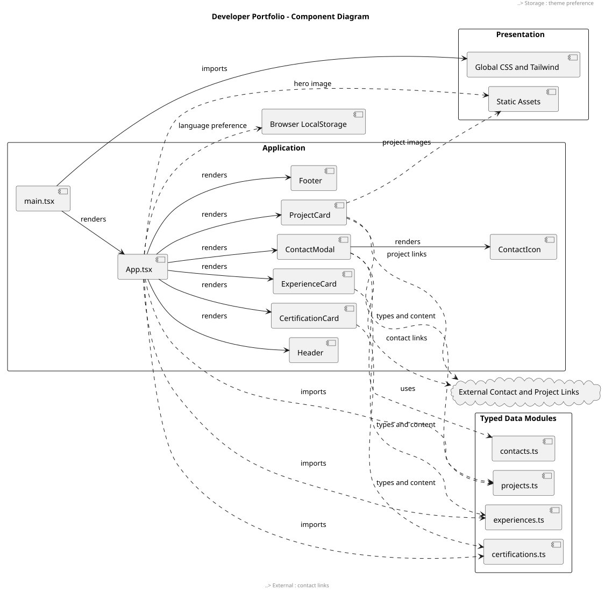

# Software Architecture — Developer Portfolio

## Purpose and System Boundary

Developer Portfolio is a bilingual, client-side single-page application built with React, TypeScript, Vite, and Tailwind CSS. The application is compiled into static HTML, JavaScript, CSS, fonts and images and deployed through **Vercel**.

**Inside the system:** page composition, portfolio content, visual components, interaction state, browser preferences and static assets.  
**Outside the system:** GitHub, project demo sites, LinkedIn, WhatsApp, email handlers, certificate-verification services and other linked destinations.

There is **no portfolio-specific backend API, authentication service or application database**. External links do not make those services part of this app's runtime architecture.

## Architecture Overview

[PlantUML source](diagrams/components.puml). The illustration intentionally shows core components and relationships, **not every current component**. The tables below describe the additional implemented parts.

### Entry Points and Data Flow

1. `src/main.tsx` imports global CSS and mounts the React application.
2. `src/App.tsx` composes page sections and controls interface selections, language, dialogs and section reveal behavior.
3. Typed, local modules under `src/data/` provide content and relationships; they are bundled into the JavaScript build.
4. Reusable components under `src/components/` render content and interactive controls.
5. The browser keeps language and theme preferences in `localStorage`. Portfolio content is **not** fetched from a dedicated backend.
6. Links and downloads use browser navigation and static assets; no server-side contact submission exists.

## Implementation Structure

| Location | Responsibility |
| --- | --- |
| `src/App.tsx` | Sections, state coordination, translations, selections and dialogs |
| `src/components/Header.tsx` | Navigation, language/theme controls and mobile menu |
| `src/components/HeroMascot.tsx` | Optimized whole-frame mascot animation and click/tap reaction |
| `src/components/ProjectCard.tsx` | Project summaries, images, outbound links and stack chart |
| `src/components/ProjectDetailsDialog.tsx` | Structured technical details and dialog behavior |
| `src/components/ProjectStackChart.tsx` | Visualization of manually maintained technology/file associations |
| `src/components/ExperienceTimeline.tsx`, `ExperienceCard.tsx` | Experience selection and related-project navigation |
| `src/components/CertificationCard.tsx` | Certifications, details and verification links |
| `src/components/ContactModal.tsx`, `ContactIcon.tsx` | Contact dialog and reusable icons |
| `src/components/TechnologyIcon.tsx` | Concept icons and locally supported brand glyphs |
| `src/components/ScrollProgress.tsx`, `Footer.tsx` | Scroll feedback, footer navigation and links |
| `src/utils/centerMobileSelection.ts` | Contained horizontal-option centering on mobile |

| Data module | Content |
| --- | --- |
| `src/data/projects.ts` | Portfolio project cards, links, bilingual descriptions and chart associations |
| `src/data/experiences.ts` | Professional experience records |
| `src/data/certifications.ts` | Education and certification records |
| `src/data/contacts.ts` | Contact channel definitions |
| `src/data/technologyProjects.ts` | Associations between technologies and displayed portfolio projects |

Projects featured in `src/data/projects.ts` can link to their **own repositories**. That is a content relationship, not a shared CI/CD or code ownership boundary.

## Interactions, Preferences and Accessibility

- Portuguese and English text is coordinated by the application; the selected language is stored under the `portfolio-language` browser storage key.
- Theme preferences are handled by the header and persisted in browser storage.
- Mobile category and project selectors scroll within constrained tracks, keeping the page width stable. One project panel is visible at a time on mobile; desktop displays a grid.
- Experience entries may navigate to a related portfolio project.
- Certification filters retain a default curated featured view and provide access to the full catalog.
- Dialogs and controls support keyboard interaction. Reveals and mascot motion respect reduced-motion behavior.

Automated checks can detect certain regressions but are **not** proof of complete WCAG compliance. See [Performance and Quality](performance-and-quality.md).

## Assets and Runtime

- Responsive WebP variants for the mascot and project illustrations in `public/images/`.
- Portuguese and English PDF résumés in `public/resumes/`.
- Local Inter/Outfit font files, a Devicon subset and inline brand vectors.
- SVG favicon and social preview metadata.

The application can be built with `npm run build` and served from `dist/`. Vercel runs the production-hosting path; the optional `Dockerfile` builds the same static output and serves it with Nginx on port 8080. The Docker runtime does **not** introduce a React server, API, database, hosted container registry or replacement for Vercel.

## CI/CD and Validation Boundaries

| Workflow | Pull Requests to `main` | Other triggers | Validation |
| --- | --- | --- | --- |
| [Continuous Integration](../.github/workflows/ci.yml) | Yes | None configured | ESLint, Vitest, build |
| [Playwright E2E Tests](../.github/workflows/playwright.yml) | Yes | None configured | Chromium functional and axe-core tests |
| [Lighthouse CI](../.github/workflows/lighthouse.yml) | Yes | None configured | Local built-site mobile/desktop audits |
| [Portfolio Docker Checks](../.github/workflows/docker.yml) | Yes | Selected `main` pushes affecting configured paths | Build and HTTP smoke-test Nginx image |

Each workflow is independent. Lighthouse creates **three runs per device profile**, with advisory category-score warnings and enforced metadata/collection checks; reports are uploaded to GitHub Actions artifacts for seven days. It measures the **local compiled build**, not public Vercel Production. Vercel Preview and Production deployment checks are independent of GitHub Actions.

The repository's `main` branch is the integrated production branch. The normal change process is Issue → branch → Pull Request → review and required checks → owner merge → production verification.

## Design Decisions and Related Documents

- [ADR 0001 — Client-side React architecture](decisions/0001-client-side-architecture.md)
- [ADR 0002 — Development and CI/CD workflow](decisions/0002-ci-cd-workflow.md)
- [ADR 0003 — Optimized local assets](decisions/0003-local-assets-performance.md)
- [ADR 0004 — Accessible motion and mobile navigation](decisions/0004-accessible-motion-mobile-navigation.md)
- [Use cases](use-cases.md) · [Quality and evidence](performance-and-quality.md) · [Documentation index](README.md)

This document describes implemented portfolio behavior. Optional cross-browser coverage or future cloud experiments are **not** current production dependencies.
