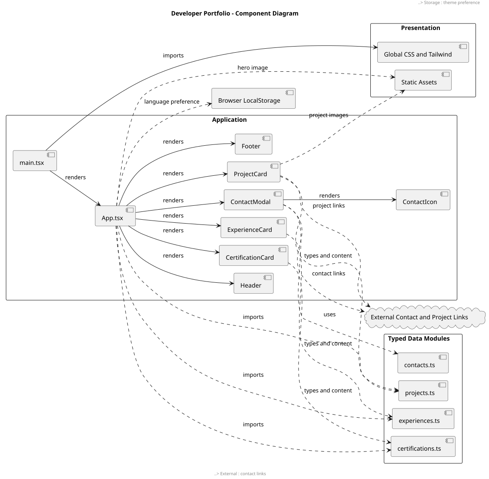

# Software Architecture

## Overview

Developer Portfolio is a client-side, single-page application built
with React, TypeScript, Vite, and Tailwind CSS.

The production build consists of static HTML, JavaScript, CSS,
images, icons, and font files hosted on Vercel.

The application does not require its own backend server or database.

## Component Diagram

Source: [PlantUML component diagram](diagrams/components.puml).

The diagram describes the application's principal components,
data dependencies, browser storage, and external destinations.
It is an architectural overview, not a complete class diagram.

## Application Entry Point

`src/main.tsx` mounts the React application and imports global
styles from `src/index.css`.

`src/App.tsx` coordinates the main portfolio sections, language
selection, content rendering, and contact dialog visibility.

## Component Responsibilities

| Component | Responsibility |
| --- | --- |
| `Header` | Navigation, language controls, theme controls, and responsive menu behavior. |
| `ProjectCard` | Display project details, expandable content, and available external links. |
| `ExperienceCard` | Display professional experience and expandable details. |
| `CertificationCard` | Display certification information and available verification mechanisms. |
| `ContactModal` | Provide an accessible dialog for professional contact channels. |
| `Footer` | Present footer navigation and contact links. |
| `ContactIcon` | Render icons shared by contact-related components. |

Other portfolio sections, including the Hero, About Me,
Technologies, and Education, are coordinated within `App.tsx`.

## Data Organization

The `src/data/` directory contains typed application content:

- `projects.ts`: project descriptions, technologies, and links.
- `experiences.ts`: professional experience records.
- `certifications.ts`: education and certification records.
- `contacts.ts`: professional contact channel definitions.

The data is bundled into the frontend application. It is not
retrieved from a dedicated portfolio API or database.

## State and Preferences

React state controls interactions such as expandable details,
language selection, and dialog visibility.

The application stores language and theme preferences in the
browser's LocalStorage.

No user authentication or account system is implemented.

## Styling and Static Assets

Tailwind CSS and CSS custom properties define the presentation
and the light and dark color themes.

Static assets include:

- Responsive WebP images.
- The custom SVG favicon.
- The social sharing preview image.
- Locally hosted Inter and Outfit font files.
- A reduced local Devicon font subset.

The site does not depend on external Google Fonts or jsDelivr
requests to load these fonts and icons.

## External Integrations

The portfolio uses browser navigation and links to access
external destinations, such as GitHub, LinkedIn, WhatsApp,
email handlers, project demos, and verification portals.

These integrations do not constitute a server-side backend.

## Deployment Architecture

GitHub is the source code repository.

Pull Requests targeting `main` trigger GitHub Actions checks
for ESLint, automated tests, and the production build.

Vercel builds and hosts the static application. Feature branches
are reviewed through Vercel Preview, while approved changes
merged into `main` are published to Production.

The domain `alexandroleao.com.br` has been purchased and added
to Vercel. DNS configuration and verification are pending.

## Related Documentation

- [Visitor use cases](use-cases.md)
- [Contributing and development workflow](../CONTRIBUTING.md)
- [Main README](../README.md)

This documentation reflects the implemented architecture.
Planned features and future infrastructure experiments should
not be interpreted as current production dependencies.
