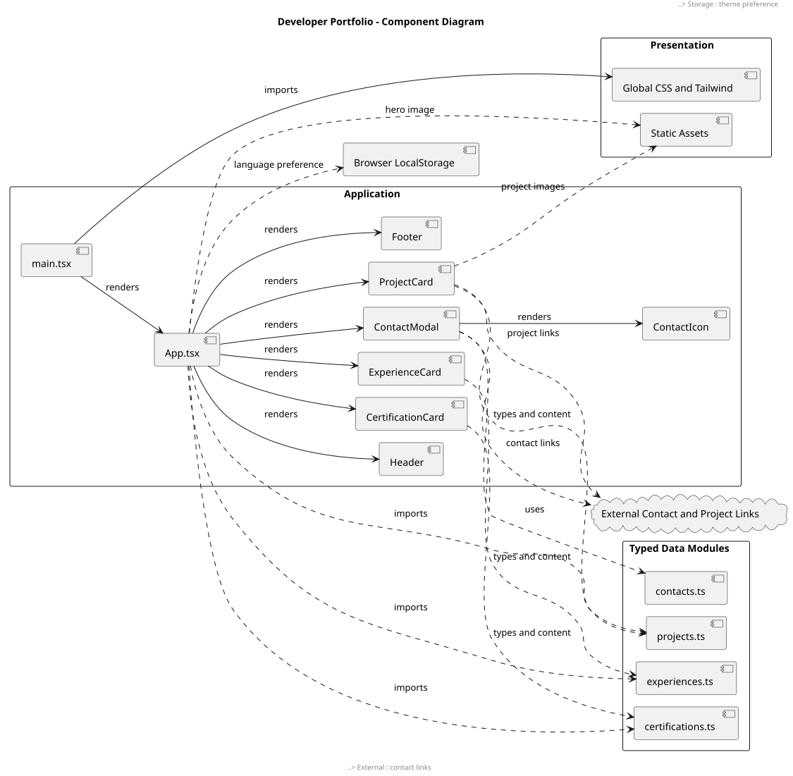

# Software Architecture

## Overview

Developer Portfolio is a client-side, single-page application built
with React, TypeScript, Vite, and Tailwind CSS.

The production build consists of static HTML, JavaScript, CSS,
images, icons, and font files hosted on Vercel.

The application does not require its own backend server or database.

## Component Diagram

Source: [PlantUML component diagram](diagrams/components.puml).

The diagram describes the application's principal components,
data dependencies, browser storage, and external destinations.
It is a simplified architectural overview; the table below also covers
newer components and helpers that are not drawn individually.

## Application Entry Point

`src/main.tsx` mounts the React application and imports global
styles from `src/index.css`.

`src/App.tsx` coordinates the main portfolio sections, language,
technology/project/certification selection, scroll-reveal observation,
and contact dialog visibility.

## Component Responsibilities

| Component | Responsibility |
| --- | --- |
| `Header` | Navigation, language controls, theme controls, and responsive menu behavior. |
| `HeroMascot` | Render optimized stop-motion frames: continuous wave plus an exclusive click/tap reaction. |
| `ProjectCard` | Display project summary, stack visualization, and available external links. |
| `ProjectDetailsDialog` | Present structured project details and balanced visual references in an accessible dialog. |
| `ProjectStackChart` | Show each project's technology distribution. |
| `ExperienceTimeline` and `ExperienceCard` | Provide desktop timeline/mobile selection and detailed contributions, including related-project navigation. |
| `CertificationCard` | Display consistent skill chips, details dialogs, and verification mechanisms. |
| `ScrollProgress` | Indicate progress through the page. |
| `ContactModal` | Provide an accessible dialog for professional contact channels. |
| `Footer` | Present footer navigation and contact links. |
| `ContactIcon` | Render icons shared by contact-related components. |
| `TechnologyIcon` | Render neutral Lucide concepts, lightweight inline brand SVGs, or existing local Devicon glyphs without loading another icon font. |
| `centerMobileSelection` | Smoothly bring the chosen option toward the middle of a horizontal mobile selection track. |

Other portfolio sections, including the Hero, About Me,
Technologies, and Education, are coordinated within `App.tsx`.

The technology catalog contains 36 entries in six groups. Each item has a typed
`evidence` value (`implemented`, `studied`, `studying`, or `planned`)
and localized explanatory text. The evidence badge appears in the details
panel only, not on every card, to preserve consistent card dimensions.
Desktop grids use category-specific column counts; mobile keeps two columns
and an internally scrolling category selector. A short selection prompt
uses the existing detail-panel space before an item is chosen.

## Data Organization

The `src/data/` directory contains typed application content:

- `projects.ts`: project descriptions, technologies, and links.
- `experiences.ts`: professional experience records.
- `certifications.ts`: education and certification records.
- `contacts.ts`: professional contact channel definitions.
- `technologyProjects.ts`: relationships between technologies and portfolio projects.

The data is bundled into the frontend application. It is not
retrieved from a dedicated portfolio API or database.

## State and Preferences

React state controls the selected technology/project/experience,
certification view and category, dialog visibility, language, and
the mascot's temporary click reaction.

The application stores language and theme preferences in the
browser's LocalStorage.

No user authentication or account system is implemented.

## Responsive Interaction Model

- On desktop, all project cards are visible in a grid; mobile shows
  one project panel at a time, changed by a horizontal selection track.
- Technologies, experience entries, and certification categories
  use horizontally scrollable tracks on supported mobile widths.
  Selecting an option calls `centerMobileSelection` so the active item
  moves gently toward the middle without shifting the page width.
- The Experience timeline can navigate to its related project.
  Mobile selects the corresponding project panel before scrolling;
  desktop scrolls to the target project card.
- Certifications default to three curated featured items on desktop
  and mobile. Selecting "All" or a knowledge area makes the broader
  catalog accessible, including an ongoing Java bootcamp.

## Motion and Accessibility

`HeroMascot` swaps complete responsive WebP character frames instead
of manipulating an isolated hand layer. The two waving poses alternate
via stepped CSS keyframes; a click/tap temporarily shows the distinct
reaction pose. Only the applicable frame is visible at a time.

`App.tsx` observes scroll-reveal regions with `IntersectionObserver`.
CSS opacity and small translate transitions create reversible section
entrances when scrolling down or up. The implementation bypasses
observation and animation under `prefers-reduced-motion: reduce`.
Semantic controls and keyboard-focus styling remain available.

## Styling and Static Assets

Tailwind CSS and CSS custom properties define the presentation
and the light and dark color themes.

Static assets include:

- Responsive WebP images for project artwork and the three mascot poses.
- Language-specific Portuguese and English PDF resumes.
- The custom SVG favicon.
- The social sharing preview image.
- Locally hosted Inter and Outfit font files.
- A reduced local Devicon font subset and lightweight inline Simple Icons
  brand paths for catalog entries absent from the subset.

The site does not depend on external Google Fonts or jsDelivr
requests to load these fonts and icons.

The site uses responsive image sources so the browser can choose a
smaller asset for narrower viewports. The production build remains
a static frontend with no special image-processing service at runtime.

## External Integrations

The portfolio uses browser navigation and links to access
external destinations, such as GitHub, LinkedIn, WhatsApp,
email handlers, project demos, and verification portals.

These integrations do not constitute a server-side backend.

## Deployment Architecture

GitHub is the source code repository.

Pull Requests targeting `main` trigger three independent GitHub Actions workflows:

- `.github/workflows/ci.yml` runs ESLint, Vitest component/application tests, and the production build.
- `.github/workflows/lighthouse.yml` independently builds `dist/` and uses pinned Lighthouse CI CLI for three mobile and three desktop audits, storing HTML/JSON reports as seven-day Actions artifacts (no external LHCI server).
- `.github/workflows/playwright.yml` installs headless Chromium and runs **21 browser checks**: 10 functional E2E regression scenarios covering languages, themes, project details, résumé downloads, mobile navigation, keyboard focus and dialogs, link destinations, reduced motion, and horizontal overflow, plus **11 axe-core accessibility audits**.

The Playwright tests live in `e2e/` and start the existing Vite development server. Development-only `@axe-core/playwright` runs WCAG A/AA rule checks on PT/EN homepages and representative dialogs without changing application architecture. They do not add a backend or change the deployed application architecture.

Vercel builds and hosts the static application. Feature branches
are reviewed through Vercel Preview, while approved changes
merged into `main` are published to Production.

The primary domain `alexandroleao.com.br` is connected to
Vercel Production with validated DNS configuration.
The `www` subdomain redirects to the apex domain using HTTP 308.

## Related Documentation

- [Visitor use cases](use-cases.md)
- [Performance and quality evidence](performance-and-quality.md)
- [Accessible motion and mobile navigation decision](decisions/0004-accessible-motion-mobile-navigation.md)
- [Post-release changelog](../CHANGELOG.md)
- [Contributing and development workflow](../CONTRIBUTING.md)
- [Main README](../README.md)

This documentation reflects the implemented architecture.
Planned features and future infrastructure experiments should
not be interpreted as current production dependencies.
