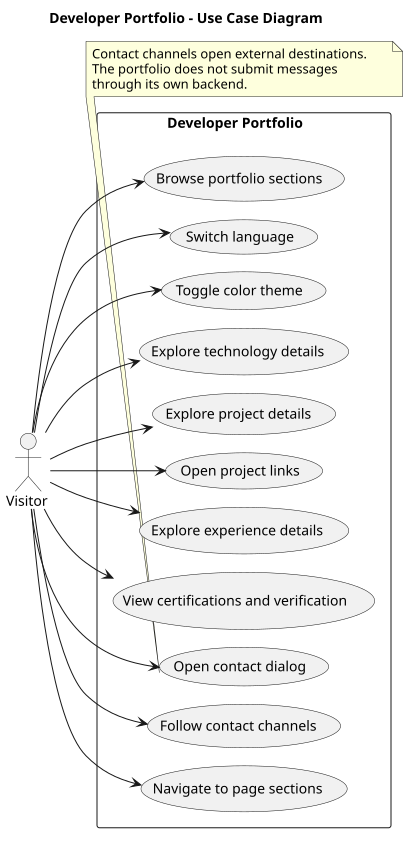

# Use Cases

This document describes the visitor-facing use cases implemented in
the Developer Portfolio.

## Scope

The portfolio is a static React application presenting professional
information, projects, technologies, experience, education, certifications,
and contact channels.

**Primary actor:** Visitor.

**System boundary:** The Developer Portfolio web application.

External services such as GitHub, LinkedIn, certification portals, and
email handlers are outside the application's system boundary.

## Use Case Diagram

Source: [PlantUML use case diagram](diagrams/use-cases.puml).

The diagram uses PlantUML syntax and can be rendered with a compatible
PlantUML viewer or editor. GitHub displays the source file; rendering
the UML image requires a compatible renderer.

## Use Case Catalog

| ID | Use case | Expected behavior |
| --- | --- | --- |
| UC-01 | Browse portfolio sections | Read the introduction, background, skills, projects, experience, education, certifications, and contact information. |
| UC-02 | Switch language | Change between Portuguese and English interface content. |
| UC-03 | Toggle color theme | Switch between the light and dark color themes. |
| UC-04 | Explore technology details | Select a technology to read how it is used or studied. |
| UC-05 | Explore project details | Expand project cards to inspect additional information. |
| UC-06 | Open project links | Follow available repository or live-demo links to external destinations. |
| UC-07 | Explore experience details | Expand professional experience entries to view additional details. |
| UC-08 | View certifications and verification | Explore certification details and use available verification links or codes. |
| UC-09 | Open contact dialog | Open and close the dialog containing professional contact channels. |
| UC-10 | Follow contact channels | Open available email, GitHub, LinkedIn, and WhatsApp destinations. |
| UC-11 | Navigate to page sections | Use navigation links, scrolling, and the back-to-top control. |

## Relevant Behavior and Constraints

- Interface content supports Portuguese and English.
- Light and dark themes are available.
- Language and theme preferences are stored locally in the browser.
- Some project links or certification verification methods depend on the
  available data for each entry.
- Contact actions use external links or browser handlers; no application
  backend stores or sends messages.
- The resume control is currently disabled and displays
  "Currículo em breve" or "Résumé coming soon".
- Downloading a resume is **not yet an implemented use case**.
- The portfolio does not provide visitor authentication or accounts.

## Traceability

The use cases correspond primarily to:

- [Application and Hero](../src/App.tsx)
- [Header](../src/components/Header.tsx)
- [Project cards](../src/components/ProjectCard.tsx)
- [Experience cards](../src/components/ExperienceCard.tsx)
- [Certification cards](../src/components/CertificationCard.tsx)
- [Contact dialog](../src/components/ContactModal.tsx)
- [Contact data](../src/data/contacts.ts)

The diagram documents existing user interactions. It does not represent
a new feature, an authentication system, or a server-side workflow.
