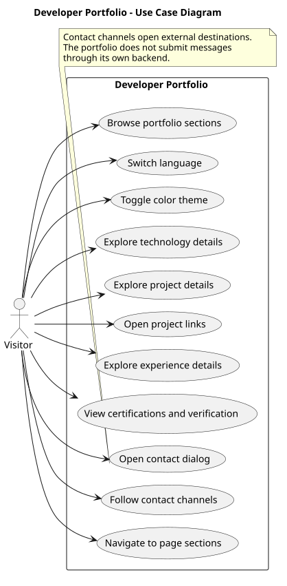

# Use Cases

This document describes the visitor-facing use cases implemented in
the Developer Portfolio.

## Scope

The portfolio is a static React application presenting professional
information, projects, technologies, experience, education, certifications,
and contact channels.

**Primary actor:** Visitor.

**System boundary:** The Developer Portfolio web application.

External services such as GitHub, LinkedIn, certification portals, and
email handlers are outside the application's system boundary.

## Use Case Diagram

Source: [PlantUML use case diagram](diagrams/use-cases.puml).

The diagram illustrates the foundational use cases. The catalog below
also documents later interaction refinements without treating the
diagram as an exhaustive list. The PlantUML source can be rendered
with a compatible viewer or editor.

## Use Case Catalog

| ID | Use case | Expected behavior |
| --- | --- | --- |
| UC-01 | Browse portfolio sections | Read the introduction, background, skills, projects, experience, education, certifications, and contact information. |
| UC-02 | Switch language | Change between Portuguese and English interface content. |
| UC-03 | Toggle color theme | Switch between the light and dark color themes. |
| UC-04 | Explore technology details | Select a category and technology; on mobile, the selected option moves gently toward the center of the horizontal track. |
| UC-05 | Explore project details | Open the structured project-details dialog, including highlights, implementation notes, and visual references. |
| UC-06 | Open project links | Follow available repository or live-demo links to external destinations. |
| UC-07 | Explore experience details | Select a timeline entry, review its contributions and skills, and navigate to a related project when available. |
| UC-08 | View certifications and verification | Review three default highlights, switch to the full catalog or a knowledge area, open details, and use available verification links or codes. |
| UC-09 | Open contact dialog | Open and close the dialog containing professional contact channels. |
| UC-10 | Follow contact channels | Open available email, GitHub, LinkedIn, and WhatsApp destinations. |
| UC-11 | Navigate to page sections | Use navigation links, scrolling, and the back-to-top control. |
| UC-12 | Download a résumé | Download the Portuguese or English PDF corresponding to the selected language. |
| UC-13 | Interact with the Hero mascot | Watch the repeating two-frame wave and click/tap the character to trigger a temporary reaction frame. |
| UC-14 | Navigate mobile selections | Scroll through technology, project, experience, and certification options without widening the page; selected options are brought toward the track's center. |
| UC-15 | See section reveals | As sections enter the viewport while scrolling in either direction, view subtle reveal animations unless reduced motion is preferred. |

## Relevant Behavior and Constraints

- Interface content supports Portuguese and English.
- Light and dark themes are available.
- Language and theme preferences are stored locally in the browser.
- Some project links or certification verification methods depend on the
  available data for each entry.
- Contact actions use external links or browser handlers; no application
  backend stores or sends messages.
- The Hero uses optimized image frames; only one pose is visible at a time.
- Mobile horizontal selection tracks scroll internally rather than expanding the page width.
- The three-item featured certification view is a curated default, not the entire catalog.
- Scroll-reveal effects respect the browser's reduced-motion preference.
- Portuguese and English resume PDFs are available as public static assets.
- The portfolio does not provide visitor authentication or accounts.

## Traceability

The use cases correspond primarily to:

- [Application and Hero](../src/App.tsx)
- [Header](../src/components/Header.tsx)
- [Project cards](../src/components/ProjectCard.tsx)
- [Project details dialog](../src/components/ProjectDetailsDialog.tsx)
- [Experience cards](../src/components/ExperienceCard.tsx)
- [Experience timeline](../src/components/ExperienceTimeline.tsx)
- [Certification cards](../src/components/CertificationCard.tsx)
- [Hero mascot](../src/components/HeroMascot.tsx)
- [Mobile selection helper](../src/utils/centerMobileSelection.ts)
- [Contact dialog](../src/components/ContactModal.tsx)
- [Contact data](../src/data/contacts.ts)

The diagram documents existing user interactions. It does not represent
a new feature, an authentication system, or a server-side workflow.
