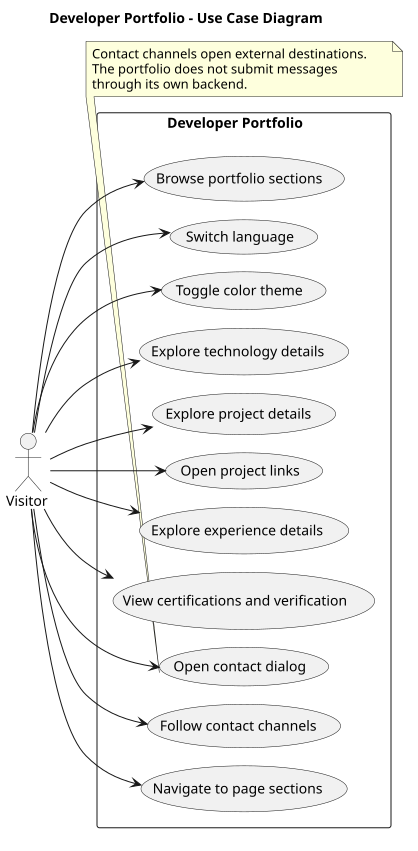

# Visitor Use Cases — Developer Portfolio

## Scope and Actors

This document specifies visitor-facing interactions **implemented in Developer Portfolio**, a static bilingual React single-page application.

- **Primary actor:** Visitor.
- **System boundary:** The portfolio web application.
- **External destinations:** GitHub, LinkedIn, email/WhatsApp handlers, certification-verification portals and project demos. They are outside the system boundary.

The portfolio does not create visitor accounts, authenticate users, store contact messages or host the backends of featured projects.

## Use-Case Diagram

[PlantUML source](diagrams/use-cases.puml). The diagram captures **11 foundational use cases**; the catalog below also covers four later interaction refinements. It is intentionally a simplified view rather than a one-to-one rendering of every catalog row.

## Use-Case Catalog

| ID | Visitor goal | Implemented behavior |
| --- | --- | --- |
| UC-01 | Browse professional sections | Read introduction, background, technologies, projects, experience, education, certifications and contact content |
| UC-02 | Switch language | Select Portuguese or English interface content |
| UC-03 | Switch color theme | Toggle the light/dark appearance |
| UC-04 | Explore technology details | Select a category and technology; review explanatory evidence text |
| UC-05 | Review project details | Open a project dialog with its structured implementation information and visual references |
| UC-06 | Follow project links | Navigate to available repository or live-demo destinations |
| UC-07 | Explore professional experience | Select an experience entry and, where available, navigate to its related project |
| UC-08 | Explore certifications | View featured qualifications, open the full catalog, filter and access verification links/codes where provided |
| UC-09 | Open contact dialog | Open, inspect and dismiss the professional contact dialog |
| UC-10 | Use contact channels | Follow available email, GitHub, LinkedIn and WhatsApp destinations |
| UC-11 | Navigate between sections | Use page anchors, menu controls and back-to-top behavior |
| UC-12 | Download a résumé | Access the public PDF for the currently selected interface language |
| UC-13 | Interact with the mascot | View repeating wave frames and trigger a temporary reaction by clicking/tapping |
| UC-14 | Use mobile selectors | Scroll contained option tracks and bring selected items toward the center without expanding the document width |
| UC-15 | Observe section reveals | Display subtle scroll-triggered transitions, omitted or reduced when the visitor prefers reduced motion |

## Functional Constraints

- The interface supports Portuguese and English; language and theme preferences persist in the browser.
- Availability of project demos and verification links depends on the data for each item and the external destination.
- Contact actions open browser handlers/external services; the portfolio has **no contact-submission backend**.
- Project stack charts are curated associations, not automatically scanned repository statistics.
- A selected mobile project replaces the visible project panel; desktop presents the project grid.
- Certification highlights are a subset of the full catalog.
- Motion effects must not prevent access to content with reduced motion enabled.
- Résumé files are public static assets; original private educational records are not offered as public downloads.

## Traceability

| Use-case group | Main implementation |
| --- | --- |
| UC-01, UC-02, UC-04, UC-08, UC-11, UC-14, UC-15 | [Application](../src/App.tsx) |
| UC-02, UC-03, UC-11 | [Header](../src/components/Header.tsx) |
| UC-05, UC-06 | [Project cards](../src/components/ProjectCard.tsx), [details dialog](../src/components/ProjectDetailsDialog.tsx) |
| UC-07 | [Experience timeline](../src/components/ExperienceTimeline.tsx) |
| UC-08 | [Certification cards](../src/components/CertificationCard.tsx) |
| UC-09, UC-10 | [Contact dialog](../src/components/ContactModal.tsx), [contact data](../src/data/contacts.ts) |
| UC-12 | [Header](../src/components/Header.tsx), [résumé assets](../public/resumes/) |
| UC-13 | [Hero mascot](../src/components/HeroMascot.tsx) |
| UC-14 | [Mobile selection helper](../src/utils/centerMobileSelection.ts) |

Automated regression coverage is described in [Performance and Quality](performance-and-quality.md). This catalog describes the portfolio's existing UI, not future features or behavior promised by external projects.
